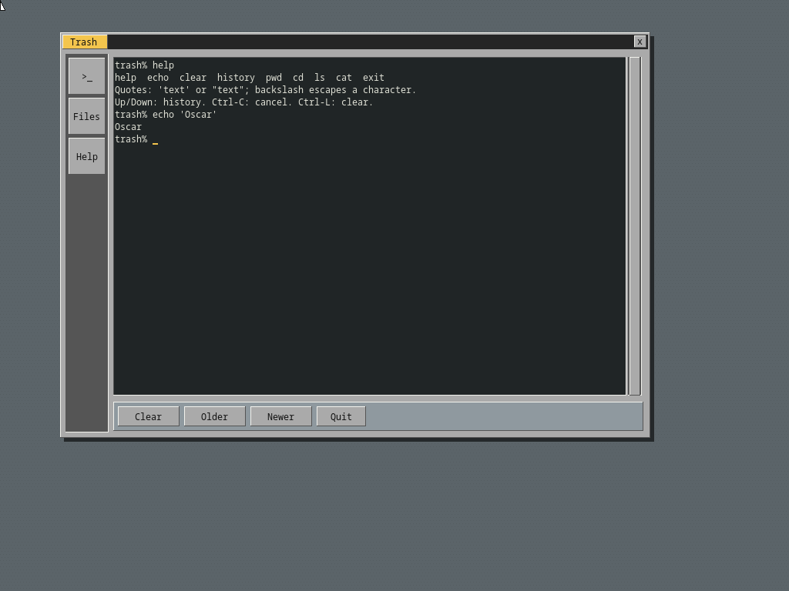

# Oscar desktop

A separate workspace for Oscar's window server, GUI toolkit, Trash shell and
terminal emulator. Nothing here is included by `dross/build.sh`, the main dross
workspace, init, the hardware boot configuration, or the USB driver. Builds and
snapshots stay in this directory's `target/`. No GPU driver is used.



## Run on the host

```sh
cd dross/desktop
cargo run -p oscar-desktop-host
# Terminal emulator connected to a real PTY:
cargo run -p oscar-desktop-host -- --exec /bin/sh
# Deterministic protocol-to-framebuffer exercise, with no display required:
cargo run -p oscar-desktop-host -- --headless target/desktop.ppm help "echo 'Oscar'"
```

Drag the title bar to move a window. Click its close box to close it. Click the
terminal to type. Ctrl-Tab moves between the terminal and the controls; Tab and
Shift-Tab move between controls, and Enter activates a button. Alt-Tab cycles
windows when more than one connection is provisioned. Page Up/Down, the Older/Newer
buttons, and the scrollbar move through terminal history.

Trash supports `help`, `echo`, `clear`, `history`, `pwd`, `cd`, `ls`, `cat`, and
`exit`, single and double quotes, backslash escaping, cursor editing, and 64 commands
of history. Ctrl-C cancels input; Ctrl-L clears the screen; Ctrl-A/E move to the
start/end; Ctrl-U erases the prefix; Ctrl-D exits an empty prompt. The host backend
reads the actual filesystem with the launching user's privileges. The native
backend exposes only the read-only `file/*` capabilities in its bootstrap message.
There are no invented filesystem entries. Pipes, redirection, expansion, and
external commands are not part of Trash's initial command language. Use `--exec`
for an existing shell and its normal process semantics.

## Structure

```text
session supervisor
    ├── windowd ← trusted seat input
    │     └── exclusive display memory
    └── Trash / Terminal
          ├── UI toolkit → Canvas → protocol → windowd
          ├── terminal model ← byte stream
          └── Trash interpreter → filesystem capability backend
```

| Component | Responsibility |
| --- | --- |
| `core/src/protocol.rs` | Versioned packets, exact length checking, bounded uploads and typed input |
| `core/src/canvas.rs` | Clipped XRGB8888 surfaces, text rasterization, blitting |
| `core/src/server.rs` | Window ownership, quotas, staging/presentation, focus, stacking, decoration, drag, input capture and composition |
| `core/src/ui.rs` | Theme, bevels, row layout, buttons, scrollbar, stable IDs and keyboard/pointer focus |
| `core/src/terminal.rs` | Streaming terminal parser, cell grid, scroll regions, bounded history, alternate screen, drawing and key encoding |
| `core/src/shell.rs` | Trash parser, line editing, commands and filesystem interface |
| `core/src/app.rs` | Trash/Terminal client, dock and front panel, upload/acknowledgement lifecycle |
| `host/` | Host display/input, real PTYs, filesystem, headless PPM output |
| `native/` | Dross channel/display adapters and opt-in process launcher |

The entire core is `no_std + alloc`, without global state, syscalls, MMIO, or host
dependencies. Its modules express independent policy; adapters provide mechanisms.
The host deliberately serializes and decodes messages on both sides, exercising
the native wire format rather than reaching into compositor internals.

The visual recipe is 60% NeXTSTEP (charcoal titles, gray bevels, compact vertical
dock), 30% CDE (inset front panel, slate surfaces, grouped controls), 10% System 6
(monochrome marks, crisp borders, stippled desktop), plus 10% BeOS (yellow title
tabs). These are toolkit theme constants and rendering primitives, not image
assets. Controls have concrete actions; the UI carries no infrastructure labels.

## Oscar chat

`chat/` talks to Oscar the Grouch through a trashcan server's Responses API: `oscar-chat` in a terminal, and
`oscar-chat-gui`, the chat window (`core/src/chat.rs`), a Linux program on dross that connects to windowd as a
`client/NAME` that `oscar-session` passes through. Enter sends; Page Up and Page Down scroll; Clear starts a new
conversation. Arguments to either are an opening message, said first. The server comes from `--server HOST:PORT` (or the window's `server` value), `OSCAR_CHAT_SERVER`,
a `server HOST:PORT` line in `/etc/oscar-chat.conf`, else 127.0.0.1:8000.

```sh
cargo run -p oscar-chat --bin oscar-chat -- --server HOST:8000
```

A new window opens beside the open ones when it fits on the screen, else cascaded over them.

## Build and verify

```sh
cargo test --workspace
cargo clippy --workspace --all-targets -- -D warnings
cargo build -p oscar-desktop-native --features native --bins --target x86_64-unknown-none
cargo clippy -p oscar-desktop-native --features native --bins --target x86_64-unknown-none -- -D warnings
```

The native build produces `oscar-windowd`, `trash`, `oscar-terminal` and
`oscar-session` in this workspace's target directory. It does not copy them into
an ESP. See [DESIGN.md](DESIGN.md) for the protocol, resource model, bootstrap
contracts, integration boundary and current limits.

Tests cover malformed/truncated wire data, ownership and input injection,
presentation atomicity, quotas and stale IDs, dragging/focus/capture, clipping,
widget activation, streaming UTF-8/ANSI, history limits, alternate screens,
shell quoting/editing, a complete serialized desktop session, and a real PTY
round trip. Host rendering and native cross-compilation have been checked, and the desktop runs on dross: in QEMU and on a
Mac Pro, on the firmware framebuffer with a USB keyboard and mouse (`../README.md`, "Oscar's desktop").
The current suite has 21 passing tests, including the host PTY test. Both host
and native Clippy checks pass with warnings denied.

For formatting, run `rustfmt` only on files in this workspace with
`--edition 2024 --config skip_children=true`. `cargo fmt --all` follows local
dependencies into the driver and kernel workspaces and should be avoided here.
